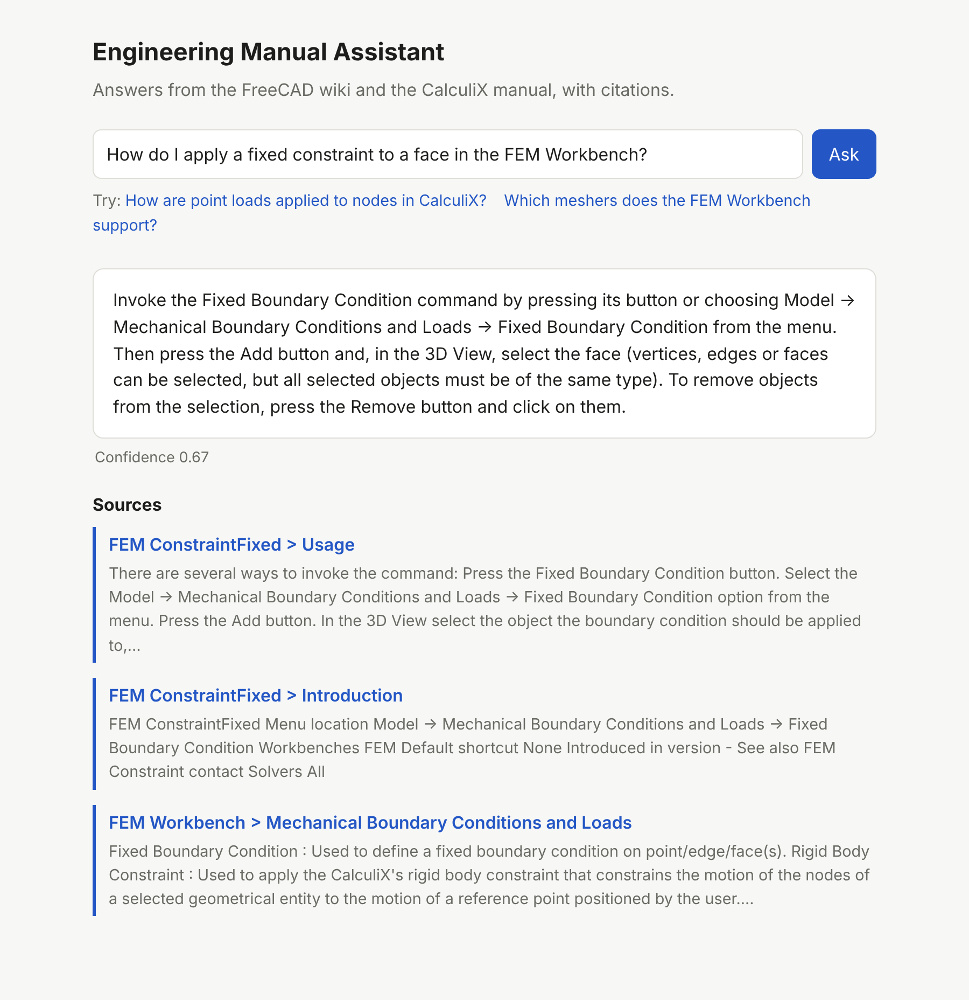
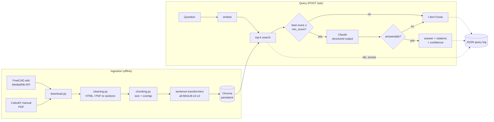

# Engineering Manual Assistant

A retrieval-augmented generation (RAG) service that answers questions about CAD/FEA
documentation — the **FreeCAD wiki** and the **CalculiX CrunchiX user's manual** — with
citations to the exact page or manual section it used, and says **"I don't know"** instead
of guessing when the documentation does not cover a question.

The focus is on the parts that make a RAG system trustworthy rather than on features:
grounded answers with verifiable citations, an explicit refusal path, structured query
logs, and an evaluation set that measures retrieval, answer correctness and refusals.



## Architecture



How an answer is produced:

1. The question is embedded and the top-k (default 5) chunks are retrieved by cosine similarity.
2. **Retrieval gate:** if the best similarity is below `MA_MIN_SCORE`, the service refuses
   without calling the LLM.
3. Otherwise Claude receives the chunks as numbered excerpts (`C1`…`C5`) and must return a
   Pydantic-validated object `{answerable, answer, cited_ids}` via structured outputs. The
   system prompt restricts it to the excerpts.
4. **Model gate:** if the model reports the excerpts don't contain the answer, the service refuses.
5. Citations are built **from the cited ids**, so a citation can only ever point at a chunk
   that was actually retrieved — the model cannot invent a source URL.
6. `confidence` is the retrieval similarity of the best cited chunk (0 on refusal).

Every query is logged as one JSON line (`logs/queries.jsonl`) with the retrieved chunk ids
and scores, retrieval and total latency, token usage, the answer and the refusal reason.

## Project layout

```
src/manual_assistant/
  sources.py      the documents to index (wiki page list, PDF URL)
  download.py     fetch raw documents into data/raw (polite, cached)
  cleaning.py     wiki HTML and PDF pages -> titled sections with source links
  chunking.py     overlapping, word-boundary chunks
  embeddings.py   sentence-transformers behind a small interface
  store.py        Chroma collection: index and search
  ingest.py       clean + chunk + index (CLI)
  search.py       retrieval-only CLI for debugging
  llm.py          Claude answer generator and optional LLM judge
  assistant.py    the pipeline: retrieve, gate, generate, log
  query_log.py    JSON-lines query logger
  api.py          FastAPI app (POST /ask, GET /health, web page)
  evaluation.py   scoring functions for the eval set
eval/
  questions.jsonl 50 questions with expected sources and key facts (5 unanswerable)
  run_eval.py     runs the eval for several chunk sizes and writes a results table
  results/        result files from the runs reported below
tests/            pytest unit tests (LLM and embeddings are faked)
```

## Setup

Requires Python 3.12 and [uv](https://docs.astral.sh/uv/).

```bash
uv sync
```

```bash
uv run python -m manual_assistant.download   # ~60 wiki pages + 1 PDF, about 10 MB
```

```bash
uv run python -m manual_assistant.ingest     # clean, chunk, embed and index (~3 min on CPU)
```

```bash
export ANTHROPIC_API_KEY=sk-ant-...
uv run uvicorn manual_assistant.api:app
```

Open http://localhost:8000 for the web page, or call the API directly:

```bash
curl -s localhost:8000/ask -H 'Content-Type: application/json' \
  -d '{"question": "Which CalculiX card does the FreeCAD force constraint use?"}'
```

Retrieval can be inspected without an API key:

```bash
uv run python -m manual_assistant.search "How do I apply a fixed constraint to a face?"
```

### Configuration

All settings are environment variables with the `MA_` prefix (see `config.py`):

| Variable | Default | Meaning |
|---|---|---|
| `MA_CHUNK_SIZE` / `MA_CHUNK_OVERLAP` | 800 / 150 | chunk size and overlap in characters |
| `MA_TOP_K` | 5 | chunks retrieved per question |
| `MA_MIN_SCORE` | 0.45 | refuse below this cosine similarity |
| `MA_LLM_MODEL` | `claude-sonnet-5-5` | answer model |
| `MA_LLM_EFFORT` | `low` | Claude effort level |
| `MA_JUDGE_MODEL` | `claude-haiku-5-5` | optional eval judge |
| `MA_COLLECTION_NAME` | `manuals` | Chroma collection to query |

### Docker

```bash
docker compose run --rm ingest     # download + index into ./data
```

```bash
ANTHROPIC_API_KEY=sk-ant-... docker compose up app
```

## Tests and linting

```bash
uv run pytest
```

```bash
uv run ruff check . && uv run ruff format --check .
```

Unit tests never touch the network: the LLM client is replaced by a fake that records the
request, and embeddings by a deterministic bag-of-words embedder. GitHub Actions runs ruff
and pytest on every push and pull request.

## Evaluation

### Method

`eval/questions.jsonl` holds 50 hand-written questions: 45 answerable (31 FreeCAD wiki,
14 CalculiX manual) and 5 that the documentation does not cover (licence prices,
other products such as Abaqus or SolidWorks). Each answerable question lists the
expected source (a page name or manual section) and one or more **key facts** a correct
answer must contain. `eval/run_eval.py` runs every question through the same
`Assistant` the API uses, for three chunk sizes (each in its own Chroma collection), and
writes per-question results to `eval/results/`.

| Metric | How it is computed |
|---|---|
| Hit rate@5 / Hit@1 | an expected source appears in the top 5 / at rank 1 of the retrieved chunks (substring match on URL or `title > section`) |
| MRR | mean of 1/rank of the first matching chunk (0 if none in the top 5) |
| Answer correct | share of the 45 answerable questions answered (not refused) with **every** key fact present |
| Key-fact recall | key facts found / key facts expected, over the answerable questions (a refusal finds none) |
| Judge correct | Claude Haiku 5.5 judges whether the answer states every key fact without contradicting them; over the answerable questions that were answered |
| Correct refusals | share of the 5 unanswerable questions answered with "I don't know" (by either gate) |
| False refusals | share of the 45 answerable questions that were refused |
| Latency | mean wall-clock time of `ask()` per question (retrieval + Claude), all 50 questions |

Key facts are matched as case-insensitive substrings after normalising whitespace and
underscores; a fact may list alternatives (`100 N|100N`). A question counts as refused
when the service returns the fixed refusal text, whether the retrieval gate
(`low_retrieval_score`) or the model (`model_unanswerable`) refused it; the reason is
recorded per question.

### Results

Full pipeline, `claude-sonnet-5-5` at effort `low`, top-k 5, `min_score` 0.45
(`uv run python eval/run_eval.py --judge`; files `eval/results/full_*`):

| Chunks (size / overlap, chars) | Hit rate@5 | Hit@1 | MRR | Answer correct | Key-fact recall | Judge correct | Correct refusals | False refusals | Latency (ms) |
|---|---|---|---|---|---|---|---|---|---|
| 400 / 80 | 0.978 | 0.911 | 0.935 | 0.889 | 0.891 | 0.929 | 1.0 | 0.067 | 2540 |
| 800 / 150 | 0.978 | 0.867 | 0.919 | 0.889 | 0.906 | 0.902 | 1.0 | 0.089 | 2160 |
| 1200 / 200 | 0.956 | 0.867 | 0.904 | 0.933 | 0.938 | 0.930 | 1.0 | 0.044 | 2003 |

Retrieval only, refusal decided by the 0.45 threshold alone, no LLM
(`uv run python eval/run_eval.py --retrieval-only`; files `eval/results/retrieval_*`):

| Chunks | Hit rate@5 | Hit@1 | MRR | Correct refusals | False refusals |
|---|---|---|---|---|---|
| 400 / 80 | 0.978 | 0.911 | 0.935 | 0.4 | 0.0 |
| 800 / 150 | 0.978 | 0.867 | 0.919 | 0.4 | 0.0 |
| 1200 / 200 | 0.956 | 0.867 | 0.904 | 0.4 | 0.0 |

### Cost and latency

The full run made 144 answer calls (48 per chunk size; the retrieval gate refused 2
questions before the LLM) plus 126 judge calls.

| Chunks | Sonnet input tokens | Sonnet output tokens | Median latency | p95 latency |
|---|---|---|---|---|
| 400 / 80 | 67,466 | 5,152 | 2.1 s | 5.1 s |
| 800 / 150 | 84,922 | 5,637 | 1.9 s | 4.6 s |
| 1200 / 200 | 95,064 | 5,313 | 1.9 s | 3.5 s |
| **Total** | **247,452** | **16,102** | | |

At $2 / $10 per million input / output tokens that is about **$0.66** for the answers,
or roughly $0.004 per question at the default chunk size. Judge token usage is not
recorded by the harness; at Haiku 5.5 prices ($0.10 / $0.50 per million) the 126 short
judge calls cost a few cents at most. Retrieval itself takes 30–80 ms on CPU; almost all
latency is the Claude call. Larger chunks mean more input tokens per question (about
1,400 at 400 chars vs. 2,000 at 1,200) but slightly lower latency.

### Interpretation

- **Retrieval is not the bottleneck.** The expected source is in the top 5 for 43–44 of
  45 questions at every chunk size. Smaller chunks rank the right section first more
  often (Hit@1 0.91 vs. 0.87), but larger chunks give the model more surrounding
  context, and that wins on answer quality: 1200-char chunks have the most correct
  answers (42/45) and the fewest false refusals (2/45).
- **The two refusal gates are complementary.** The similarity threshold alone catches
  only 2 of the 5 unanswerable questions (the other three score 0.46–0.65 because they
  share vocabulary with the manuals, e.g. "maximum number of elements"); the model gate
  catches the remaining three. No unanswerable question was answered at any chunk size.
- **Most errors are conservative.** Failed answerable questions are mostly refusals
  where the retrieved text only implies the answer (q02, q27, q29), not wrong answers.
  Only one answer missed a key fact at the 800 and 1200 sizes (q30: the excerpts say
  "position and rotation" but never "quaternion", so the model correctly declined to
  add it).
- **Key-fact matching and the judge disagree in both directions.** The Haiku judge is
  stricter on some answers that contain every key fact (q07, q14), and q39's key facts
  are arguably wrong: the manual says the default is the first *installed* solver from
  a list, which the answer states correctly. Treat differences of one or two questions
  (0.02–0.04) between configurations as noise.
- The default chunk size stays at 800 / 150 for now; 1200 / 200 is the better choice on
  these numbers and is one setting away (`MA_CHUNK_SIZE=1200 MA_CHUNK_OVERLAP=200`),
  but the margin is two questions on a 45-question set.

### Known limitations

- **The refusal threshold was chosen on the eval set itself** (0.45 is the highest value
  with no false refusals in the retrieval-only sweep), so the refusal numbers above are
  optimistic; there is no held-out set. Short keyword questions score low with MiniLM:
  "What does the \*CLOAD keyword do?" retrieves the right section at 0.37 and is refused.
- **Small set.** 50 questions, only 5 unanswerable; one question moves a rate by 0.02
  (answerable) or 0.2 (unanswerable). The questions were written against the indexed pages,
  so they are likely easier than real user questions.
- **Key-fact string matching** misses paraphrases and synonyms and cannot detect
  incorrect extra claims; the optional LLM judge is a second opinion, not ground truth.
- **PDF section boundaries are approximate.** CalculiX sections come from the PDF
  outline plus page text, so a section can start or end mid-page and citations point to
  a page, not an exact paragraph.
- **Cross-source questions** such as q02 (which CalculiX card a FreeCAD constraint
  writes) need facts from both sources or from a page that only implies them; with
  independent top-k retrieval these are refused in every configuration.
- **English-only, curated subset of the wiki.** 59 hand-picked English FreeCAD
  pages (FEM, Part, PartDesign, Sketcher, general) and one manual version (CalculiX
  2.23); questions about other workbenches or translated pages are out of scope.

## Data sources and licenses

| Source | What is indexed | License |
|---|---|---|
| [FreeCAD wiki](https://wiki.freecad.org) | 59 English pages (FEM, Part, PartDesign, Sketcher, general), fetched via the MediaWiki API | [CC BY 3.0](https://creativecommons.org/licenses/by/3.0/) (as reported by the wiki's `rightsinfo`) |
| [CalculiX CrunchiX User's Manual 2.23](https://www.dhondt.de/ccx_2.23.pdf) by Guido Dhondt | the full 835-page PDF | distributed with CalculiX under the [GNU GPL v2](https://www.dhondt.de/) |
| [all-MiniLM-L6-v2](https://huggingface.co/sentence-transformers/all-MiniLM-L6-v2) | embedding model | Apache 2.0 |

The documents are downloaded at setup time and are **not** redistributed in this
repository; answers quote and link back to the original pages.
