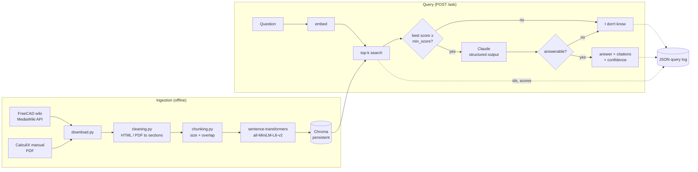

# Engineering Manual Assistant

A retrieval-augmented generation (RAG) service that answers questions about CAD/FEA
documentation — the **FreeCAD wiki** and the **CalculiX CrunchiX user's manual** — with
citations to the exact page or manual section it used, and says **"I don't know"** instead
of guessing when the documentation does not cover a question.

The focus is on the parts that make a RAG system trustworthy rather than on features:
grounded answers with verifiable citations, an explicit refusal path, structured query
logs, and an evaluation set that measures retrieval, answer correctness and refusals.


## Architecture



How an answer is produced:

1. The question is embedded and the top-k (default 5) chunks are retrieved by cosine similarity.
2. **Retrieval gate:** if the best similarity is below `MA_MIN_SCORE`, the service refuses
   without calling the LLM.
3. Otherwise Claude receives the chunks as numbered excerpts (`C1`…`C5`) and must return a
   Pydantic-validated object `{answerable, answer, cited_ids}` via structured outputs. The
   system prompt restricts it to the excerpts.
4. **Model gate:** if the model reports the excerpts don't contain the answer, the service refuses.
5. Citations are built **from the cited ids**, so a citation can only ever point at a chunk
   that was actually retrieved — the model cannot invent a source URL.
6. `confidence` is the retrieval similarity of the best cited chunk (0 on refusal).

Every query is logged as one JSON line (`logs/queries.jsonl`) with the retrieved chunk ids
and scores, retrieval and total latency, token usage, the answer and the refusal reason.

## Project layout

```
src/manual_assistant/
  sources.py      the documents to index (wiki page list, PDF URL)
  download.py     fetch raw documents into data/raw (polite, cached)
  cleaning.py     wiki HTML and PDF pages -> titled sections with source links
  chunking.py     overlapping, word-boundary chunks
  embeddings.py   sentence-transformers behind a small interface
  store.py        Chroma collection: index and search
  ingest.py       clean + chunk + index (CLI)
  search.py       retrieval-only CLI for debugging
  llm.py          Claude answer generator and optional LLM judge
  assistant.py    the pipeline: retrieve, gate, generate, log
  query_log.py    JSON-lines query logger
  api.py          FastAPI app (POST /ask, GET /health, web page)
  evaluation.py   scoring functions for the eval set
eval/
  questions.jsonl 50 questions with expected sources and key facts (5 unanswerable)
  run_eval.py     runs the eval for several chunk sizes and writes a results table
  results/        result files from the runs reported below
tests/            pytest unit tests (LLM and embeddings are faked)
```

## Setup

Requires Python 3.12 and [uv](https://docs.astral.sh/uv/).

```bash
uv sync
```

```bash
uv run python -m manual_assistant.download   # ~60 wiki pages + 1 PDF, about 10 MB
```

```bash
uv run python -m manual_assistant.ingest     # clean, chunk, embed and index (~3 min on CPU)
```

```bash
export ANTHROPIC_API_KEY=sk-ant-...
uv run uvicorn manual_assistant.api:app
```

Open http://localhost:8000 for the web page, or call the API directly:

```bash
curl -s localhost:8000/ask -H 'Content-Type: application/json' \
  -d '{"question": "Which CalculiX card does the FreeCAD force constraint use?"}'
```

Retrieval can be inspected without an API key:

```bash
uv run python -m manual_assistant.search "How do I apply a fixed constraint to a face?"
```

### Configuration

All settings are environment variables with the `MA_` prefix (see `config.py`):

| Variable | Default | Meaning |
|---|---|---|
| `MA_CHUNK_SIZE` / `MA_CHUNK_OVERLAP` | 800 / 150 | chunk size and overlap in characters |
| `MA_TOP_K` | 5 | chunks retrieved per question |
| `MA_MIN_SCORE` | 0.35 | refuse below this cosine similarity |
| `MA_LLM_MODEL` | `claude-sonnet-5-5` | answer model |
| `MA_LLM_EFFORT` | `low` | Claude effort level |
| `MA_JUDGE_MODEL` | `claude-haiku-5-5` | optional eval judge |
| `MA_COLLECTION_NAME` | `manuals` | Chroma collection to query |

### Docker

```bash
docker compose run --rm ingest     # download + index into ./data
```

```bash
ANTHROPIC_API_KEY=sk-ant-... docker compose up app
```

## Tests and linting

```bash
uv run pytest
```

```bash
uv run ruff check . && uv run ruff format --check .
```

Unit tests never touch the network: the LLM client is replaced by a fake that records the
request, and embeddings by a deterministic bag-of-words embedder. GitHub Actions runs ruff
and pytest on every push and pull request.

EVAL_PLACEHOLDER

## Data sources and licenses

| Source | What is indexed | License |
|---|---|---|
| [FreeCAD wiki](https://wiki.freecad.org) | 59 English pages (FEM, Part, PartDesign, Sketcher, general), fetched via the MediaWiki API | [CC BY 3.0](https://creativecommons.org/licenses/by/3.0/) (as reported by the wiki's `rightsinfo`) |
| [CalculiX CrunchiX User's Manual 2.23](https://www.dhondt.de/ccx_2.23.pdf) by Guido Dhondt | the full 835-page PDF | distributed with CalculiX under the [GNU GPL v2](https://www.dhondt.de/) |
| [all-MiniLM-L6-v2](https://huggingface.co/sentence-transformers/all-MiniLM-L6-v2) | embedding model | Apache 2.0 |

The documents are downloaded at setup time and are **not** redistributed in this
repository; answers quote and link back to the original pages.
